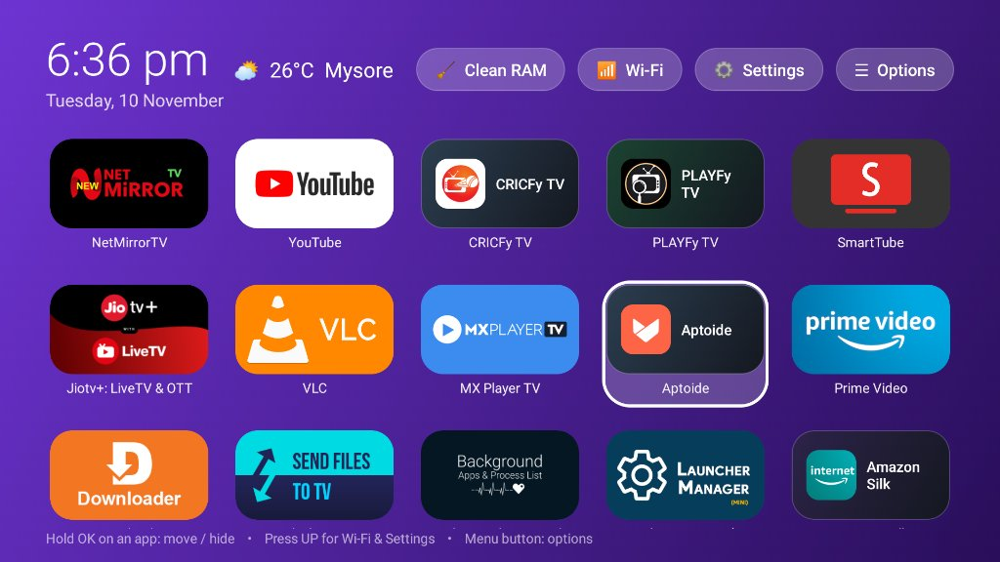

# 📺 CUSTOM FIRE LAUNCHER with CLAUD (`FIRE TV CUSTOM HS VER1`)

A fast, lightweight, ad-free custom Home Screen Launcher built for Amazon Fire TV (`com.prasad.firehome`).

---

## 🖼️ Home Screen Preview

---

## ✨ Key Features
- **5-Column Wide 16:9 Banner Grid**: Displays all TV and sideloaded apps in a clean 5-apps-per-row wide rectangular banner layout.
- **Adjustable App Icon Edge Rounding (5% to 50%)**: Round all app cards, full TV banners, inner icons, and focus borders between **5%** and **50%** (in 5% steps) directly from **⚙️ Settings** or **☰ Options**.
- **15 Refreshing Dual-Color Wallpapers**: Built-in `🎨 Choose Dual-Color Wallpaper` picker with 15 vibrant 2-tone gradients (plus custom `wallpaper.jpg` support).
- **Top Action Bar**:
  - **Clock & Date** on the top-left.
  - **Live Weather** (Default: **Mysore**, `12.2958, 76.6394`) via Open-Meteo.
  - **`🧹 Clean RAM`**: Clears background memory and automatically guides through Force-Stopping any running background user apps (`FLAG_STOPPED`) with `"Force stop"` pre-highlighted.
  - **`📶 Wi-Fi`**: Opens Fire TV Network / Wi-Fi settings.
  - **`⚙️ Settings`**: Opens Dual-Color Wallpaper Picker, Icon Edge Rounding (`5%–50%`), Fire Home Options, or Fire TV System Settings.
  - **`☰ Options`**: Switch dual-color wallpapers, adjust Icon Edge Rounding (`5%–50%`), apply custom `wallpaper.jpg`, unhide apps, or refresh weather.
- **Default Home Button Interception**: Built-in `HomeAccessibilityService` intercepts the Fire TV Home button and stock launcher window so pressing Home always opens **Fire Home**.

---

## 🚀 Quick Install on Fire TV
1. **Direct APK Download**: Download **[`FIRE_TV_CUSTOM_HS_VER1.apk`](https://github.com/Manju5555/CUSTOM-FIRE-LAUNCHER-with-CLAUD/releases/download/v1.0.0/FIRE_TV_CUSTOM_HS_VER1.apk)** and sideload it onto your Fire TV.
2. **Or One-Click PC Installer**:
   - Enable **ADB Debugging** on your Fire TV (*Settings → My Fire TV → Developer Options → ADB Debugging*).
   - Double-click **`INSTALL_ON_FIRETV.bat`** (or run `install_to_firetv.ps1 -FireTvIp <YOUR_FIRE_TV_IP>:5555`).
