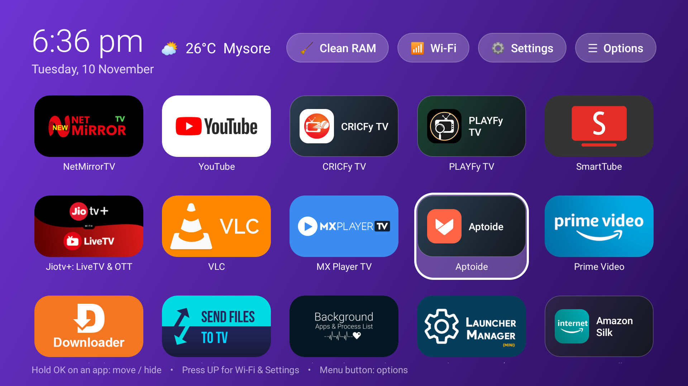

# CUSTOM FIRE LAUNCHER with CLAUD (`FIRE TV CUSTOM HS VER1`)

A fast, lightweight, ad-free custom Home Screen Launcher built for Amazon Fire TV (`com.prasad.firehome`).

## ✨ Features
- **5-Column Wide 16:9 Banner Grid**: Displays all TV and sideloaded apps in a clean 5-apps-per-row wide rectangular banner layout.
- **Adjustable App Icon Edge Rounding (5% to 50%)**: Round all app cards, full TV banners, inner icons, and focus borders between **5%** and **50%** (in 5% steps) directly from **⚙️ Settings** or **☰ Options**.
- **15 Refreshing Dual-Color Wallpapers**: Built-in `🎨 Choose Dual-Color Wallpaper` picker with 15 vibrant 2-tone gradients (plus custom `wallpaper.jpg` support).
- **Top Action Bar**:
  - **Clock & Date** on the top-left.
  - **Live Weather** (Default: **Mysore**, `12.2958, 76.6394`) via Open-Meteo.
  - **`🧹 Clean RAM`**: Clears background memory and automatically guides through Force-Stopping any running background user apps (`FLAG_STOPPED`) with `"Force stop"` pre-highlighted.
  - **`📶 Wi-Fi`**: Opens Fire TV Network / Wi-Fi settings.
  - **`⚙️ Settings`**: Opens Dual-Color Wallpaper Picker, Icon Edge Rounding (`5%–50%`), Fire Home Options, or Fire TV System Settings.
  - **`☰ Options`**: Switch dual-color wallpapers, adjust Icon Edge Rounding (`5%–50%`), apply custom `wallpaper.jpg`, unhide apps, or refresh weather.
- **Default Home Button Interception**: Built-in `HomeAccessibilityService` intercepts the Fire TV Home button and stock launcher window so pressing Home always opens **Fire Home**.

## 🚀 Quick Install on Fire TV
1. Enable **ADB Debugging** on your Fire TV (*Settings → My Fire TV → Developer Options → ADB Debugging*).
2. Double-click **`INSTALL_ON_FIRETV.bat`** (or run `install_to_firetv.ps1 -FireTvIp <YOUR_FIRE_TV_IP>:5555`).
3. Or sideload **`FIRE_TV_CUSTOM_HS_VER1.apk`** directly onto your Fire TV.

## 🛠️ Project Structure
- `FIRE_TV_CUSTOM_HS_VER1.apk` — Pre-built signed APK ready to install on any Fire TV.
- `app/src/main/java/com/prasad/firehome/HomeActivity.java` — Main launcher UI, 5-column adapter, 5%–50% corner rounding, 15 dual-color wallpapers, weather, and RAM cleaner.
- `app/src/main/java/com/prasad/firehome/HomeAccessibilityService.java` — Home button interceptor and automated `"Force stop"` assistant.
- `app/src/main/AndroidManifest.xml` — Android Manifest & permissions.
- `fast_build.ps1` / `BUILD_APK.bat` — Fast ~4-second build script using `aapt2`, `javac`, `d8`, `zipalign`, and `apksigner`.
- `install_to_firetv.ps1` / `INSTALL_ON_FIRETV.bat` — One-click ADB installer and Home button accessibility configurator.
